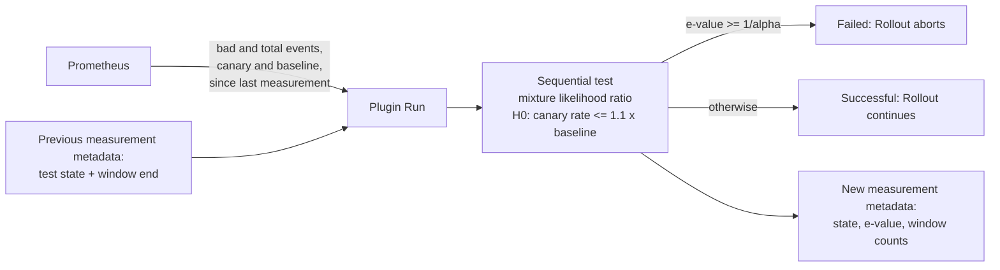

# rollouts-plugin-metric-sequential

**Canary analysis checks the same metric every minute, so a "95% confident" threshold or z-test rolls back healthy releases far more often than 5% of the time.**

This [Argo Rollouts](https://argoproj.github.io/argo-rollouts/) metric plugin compares the canary's bad-event rate (errors, slow requests) with the baseline's using an anytime-valid sequential test: Argo can check it at every analysis interval, and the chance of ever rolling back a canary that is no worse than the baseline (within a margin you set) stays below alpha.



> v0.1. The statistics are not new (see [Research lineage](#research-lineage)). What this repository adds is a working, open Argo Rollouts plugin, a reproducible benchmark against the rules people actually use, and an end-to-end test on a real cluster. The benchmark traffic is **synthetic**.

**Read more:** the full write-up on Medium, [Your Canary Analysis Checks Every Minute. Its Statistics Assume You Check Once.](https://medium.com/@harshitnagila555/your-canary-analysis-checks-every-minute-its-statistics-assume-you-check-once-c747072e73b3), and the [launch post on LinkedIn](https://www.linkedin.com/feed/update/urn:li:ugcPost:7528549386759364608/).

## Worked example

The end-to-end test ([`e2e/run.sh`](e2e/run.sh)) runs the real Argo Rollouts v1.10.2 controller with this plugin, Prometheus and a demo app that fails a set share of requests, on a kind cluster:

1. v1 → v2 with the same 1% error rate: the background analysis must stay Successful and the rollout must be promoted.
2. v2 → v3 with a 5% error rate (5x): the analysis must fail and the rollout must abort.

Result of the committed run ([`reports/e2e/summary.md`](reports/e2e/summary.md), raw AnalysisRuns in [`analysisruns.json`](reports/e2e/analysisruns.json)), with 15-second windows and roughly 100 to 360 requests per arm per window:

| Update | AnalysisRun | E-value over the run (fails at 20) | Outcome |
|---|---|---|---|
| v2, same 1% errors | Successful | stayed between 0.05 and 0.12 | promoted after the 7-minute canary |
| v3, 5% errors | Failed at the 3rd measurement | 1 → 2.3 → **1,468** | rollout aborted 55 seconds after the update |

The window counts are fractional (for example `canary 3.2/276.8 bad`) because Prometheus's `increase()` extrapolates to the window edges. This is one run, not a rate: it shows the plugin working with the real controller, not how often it is right.

## Results

From [`reports/benchmark.md`](reports/benchmark.md): 2,000 simulated rollouts per scenario, canary weight 5% → 10% → 25% → 50% with 10 analysis windows per step (40 looks), alpha = 0.05, margin = 10%. Every rule sees the same traffic.

| Rule | False rollbacks of harmless canaries (worst of 16 settings) | 2x regression at 1% base rate, 5,000 requests/window: caught / mean window / extra bad events served |
|---|---|---|
| **sequential (this plugin)** | **1.7%** | 100% / 7.2 / 19.8 |
| threshold: canary rate > 2x baseline, failureLimit 2 | 99.2% | 100% / 6.3 / 16.2 |
| z-test checked at every window ("peeking") | 30.6% | 100% / 3.7 / 9.3 |
| z-test once, at the end of the rollout | 5.0% | 100% / 40.0 / 450.1 |

The threshold rule and the peeking z-test react a little faster, and pay for it by rolling back healthy releases: the threshold rule fails 80.9% of harmless canaries when errors are rare (0.1% at 500 requests per window), the peeking z-test up to 30.6%. The single end-of-rollout test is valid but lets a regression reach 50% of traffic first, serving about 23 times more extra errors.

Negative results, also in the report:

- **Low traffic gives no verdict.** At a 0.1% base rate and 500 requests per window, a 2x regression is caught in only 13.1% of rollouts. The test does not fail closed; it needs evidence.
- **Small regressions above the margin are often missed.** A 1.25x regression at a 1% base rate is caught in 21.5% of rollouts (the peeking z-test catches 89.0%, at the cost above).
- **The per-window state did not matter here.** Running the same test statelessly on cumulative counts (`ablation-pooled`) also stayed under alpha (worst 1.8%). The per-window form is the one the guarantee is proved for when weights change, but these scenarios did not expose a difference.
- At a 20% base rate the test is conservative (0.0% false rollbacks), because the Poisson model overstates the variance of Bernoulli counts.

Regenerate: `go run ./cmd/bench` (about 2 minutes; output is byte-for-byte reproducible with the same Go version, checked in CI).

## Quick start

1. Register the released binary in the `argo-rollouts-config` ConfigMap and restart the controller. The controller downloads it at startup and refuses it if the SHA-256 does not match:

   ```yaml
   data:
     metricProviderPlugins: |-
       - name: "harshit3355/sequential"
         location: "https://github.com/harshit3355/rollouts-plugin-metric-sequential/releases/download/v0.1.0/rollouts-plugin-metric-sequential-linux-amd64"
         sha256: "5d36cae1bb36d46dd22deb72f441253b02595a76c0a9f992bfa67e50ab1a2bd3"
   ```

   On arm64 nodes use `rollouts-plugin-metric-sequential-linux-arm64` with `sha256: "5d13756937da5ee885aed419e0dc8d6d62db33370222aa2719880eff04cadee1"` (both in the release's `SHA256SUMS`). Each binary has a signed SLSA build provenance attestation; check it with `gh attestation verify <binary> --repo harshit3355/rollouts-plugin-metric-sequential`.

2. Without internet access from the controller, build the binary into an image based on the controller and point `location` at `file:///plugins/rollouts-plugin-metric-sequential` instead. The end-to-end test uses this route:

   ```sh
   CGO_ENABLED=0 GOOS=linux go build -trimpath -ldflags "-s -w" -o rollouts-plugin-metric-sequential .
   ```

   ```dockerfile
   FROM quay.io/argoproj/argo-rollouts:v1.10.2
   COPY --chmod=0755 rollouts-plugin-metric-sequential /plugins/rollouts-plugin-metric-sequential
   ```

3. Use it in an AnalysisTemplate. Each query must return one number; `$WINDOW` is replaced with the time since the previous measurement (for example `15s`), so consecutive windows do not overlap:

   ```yaml
   metrics:
     - name: regression
       interval: 15s
       failureLimit: 0
       provider:
         plugin:
           harshit3355/sequential:
             address: http://prometheus.monitoring.svc:9090
             alpha: 0.05    # chance of ever failing a canary within the margin
             margin: 0.1    # the canary may be up to 10% worse than the baseline
             canary:
               bad: sum(increase(http_requests_total{code=~"5..",rollouts_pod_template_hash="{{args.canary-hash}}"}[$WINDOW]))
               total: sum(increase(http_requests_total{rollouts_pod_template_hash="{{args.canary-hash}}"}[$WINDOW]))
             baseline:
               bad: sum(increase(http_requests_total{code=~"5..",rollouts_pod_template_hash="{{args.stable-hash}}"}[$WINDOW]))
               total: sum(increase(http_requests_total{rollouts_pod_template_hash="{{args.stable-hash}}"}[$WINDOW]))
   ```

   Pass `canary-hash` and `stable-hash` with `valueFrom.podTemplateHashValue: Latest` and `Stable`. A complete Rollout is in [`e2e/manifests/app.yaml`](e2e/manifests/app.yaml). "Bad" can be anything countable: 5xx responses, requests slower than an SLO threshold (`total - le="0.5"` bucket), failed jobs.

Optional settings: `maxRatio` (default 20, the largest regression the test is tuned for) and `points` (default 32).

## Mechanism

In each window the canary serves `n` requests and the baseline `m`. Treating bad events as Poisson with per-request rates `lc` and `lb`, the canary's share `x` of the window's `k` bad events is Binomial(`k`, θ) with θ = r·n / (r·n + m) and r = lc / lb. θ is computed from each window's own traffic, so the test stays valid when the canary weight changes between steps.

The null hypothesis is r ≤ r0 = 1 + margin. For each alternative r_j on a log-spaced grid from r0 to `maxRatio`, the running product of per-window likelihood ratios L(r_j)/L(r0) is a non-negative supermartingale under the null (the binomial family has a monotone likelihood ratio in r). Their average, the e-value, is one too, so by Ville's inequality the probability that it ever reaches 1/alpha is at most alpha, however often Argo looks. The measurement fails when it does.

The running log-likelihood ratios are stored in the measurement's `metadata.state`, with the end of the window in `metadata.windowEnd`. Each Run restores them from the newest measurement that has them, so state survives controller restarts, and a failed query only widens the next window. Changing `margin`, `maxRatio` or `points` during an analysis is an error rather than a silent reset.

Code: [`internal/seqtest`](internal/seqtest/seqtest.go) (the test), [`internal/plugin`](internal/plugin/plugin.go) (Argo glue and Prometheus).

## Failure model

| Failure | What happens |
|---|---|
| Prometheus unreachable or a query errors | Measurement `Error`; Argo's `consecutiveErrorLimit` applies. No data is lost: the next window starts at the last successful one. |
| A query returns several series | `Error`, asking for an aggregation such as `sum()`. |
| A query matches nothing (typo, wrong label) | **Reads as zero traffic, so the test never fails.** Check `metadata.windowCounts` on the first measurements. |
| `increase()` extrapolates bad above total | Bad is clamped to total. |
| Configuration changed mid-analysis | `Error`; start a new analysis. |
| Errors correlated across both arms (shared dependency) | Not a regression of the canary; the test is not designed to catch it. |

## What this does not establish

- The benchmark traffic is simulated: independent requests at constant rates. Real failures are bursty and correlated (retries, one bad node, a cold cache), which breaks the independence the guarantee needs.
- Prometheus's `increase()` extrapolates at window edges and lags behind by about a scrape interval; the simulation uses exact counts.
- The threshold rule's setting (2x the baseline rate, failureLimit 2) is one common configuration, not the best possible threshold.
- One end-to-end run on kind shows the plugin works with the real controller; it says nothing about detection rates in production.
- Argo keeps only the 10 newest measurements of a metric. The plugin needs only the newest, so this does not affect the test, but the e2e summary shows at most 10.

## Research lineage

- Lindon, Sanden, Shirikian, [Rapid Regression Detection in Software Deployments through Sequential Testing](https://arxiv.org/abs/2205.14762) (KDD 2022): sequential tests on counting processes for Netflix canaries. This is the nearest prior art; this plugin applies the same idea to Argo Rollouts.
- Johari, Pekelis, Walsh, [Always Valid Inference: Bringing Sequential Analysis to A/B Testing](https://arxiv.org/abs/1512.04922): why repeated looks at a fixed-sample test inflate false positives, and mixture tests that do not.
- Ramdas, Grünwald, Vovk, Shafer, [Game-theoretic statistics and safe anytime-valid inference](https://arxiv.org/abs/2210.01948): e-values, test martingales and Ville's inequality.
- [Kayenta](https://github.com/spinnaker/kayenta), Spinnaker's canary judge, compares canary and baseline with a Mann-Whitney test per interval.
- [canary-tribunal](https://github.com/harshit3355/canary-tribunal), my earlier simulation of anytime-valid canary decisions for LLM-judge scores.

## Roadmap

- Run the end-to-end test against the released binary (`https://` location) as well as the `file://` route.
- A latency mode on histogram buckets, with an example for an SLO threshold.
- A "prove no regression" mode that succeeds only once the canary is shown to be within the margin, for an inline analysis before promotion.

## Read more

- Medium: [Your Canary Analysis Checks Every Minute. Its Statistics Assume You Check Once.](https://medium.com/@harshitnagila555/your-canary-analysis-checks-every-minute-its-statistics-assume-you-check-once-c747072e73b3)
- LinkedIn: [launch post](https://www.linkedin.com/feed/update/urn:li:ugcPost:7528549386759364608/) · [Harshit Nagila](https://www.linkedin.com/in/harshit555)

## License

Apache-2.0
